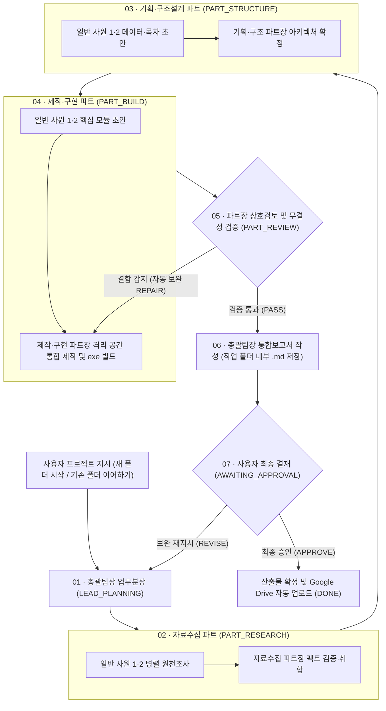
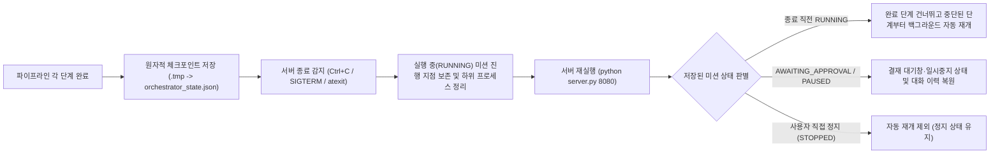

# NEXUS (VINCO) AI Virtual Office × AI DEV DIRECTOR

한국어 AI 가상 오피스 UI(`index.html`, `office.html`, `agents.html`, `settings.html`) 위에 **Antigravity Python SDK(`google-antigravity`) 및 다중 AI 코딩 CLI(Claude Code, OpenAI Codex, Google Antigravity, xAI Grok)** 오케스트레이터를 결합한 로컬 협업 플랫폼입니다.

모든 에이전트 실행 시 종량제 유료 API 키(`OPENAI_API_KEY`, `ANTHROPIC_API_KEY`, `GEMINI_API_KEY`, `GOOGLE_API_KEY` 등)를 환경변수에서 자동 제거(`get_sanitized_env`)하여 **추가 API 과금 없이(`$0`) 로컬 구독 로그인 세션만으로 동작**합니다.

---

## 1. Antigravity SDK (`antigravity_sdk`) 기능 및 계층형 협업 구조

별도의 개별 CLI 설치나 수동 API 키 발급 없이, 로컬 PC의 Antigravity 구독 세션을 공유하는 **`google-antigravity` Python SDK** 기반으로 전 직원을 구동할 수 있습니다.

### 1.1 핵심 SDK 기능
- **로컬 구독 자동 공유 (`$0` 무과금 원칙)**: 프로젝트 내 격리 가상환경(`.venv`)에 설치된 `google-antigravity` SDK(`uv pip install --python .venv google-antigravity`)가 로컬 Antigravity 로그인 세션을 그대로 활용하여 실행됩니다.
- **구독 등급(Plan) 자동 인식 및 모델 해금**: 연결된 계정의 로컬 상태 DB에서 실제 구독 등급(**Google AI Ultra / Pro / Free**)을 자동 감지하여 수동 설정 없이 사용 가능한 최신 SDK 모델(`gemini-4-carbon-high`, `claude-sonnet-4-6`, `gemini-3.8-flash-high` 등)을 활성화합니다.
- **실시간 스트리밍 & 서브에이전트 연동**: 에이전트의 사고 과정(`sdk_thought`), 도구 호출(`sdk_tool`), 응답 텍스트(`sdk_delta`)를 실시간 스트리밍하며, 소속 팀원 명단을 SDK `SubagentConfig`로 자동 구성합니다.
- **단계·규모별 자동 타임아웃 (`auto`)**: 고정된 짧은 제한 시간 대신 파이프라인 단계(`LEAD_PLANNING`, `PART_BUILD` 등), 직급, 실행 모드(`quick` / `standard` / `deep`)에 따라 제한 시간을 자동으로 여유 있게 산정(`resolve_agent_timeout`)합니다.
- **격리 빌드 공간(`iso_cwd`) & 원본 바이트 보존**: 에이전트가 임시 격리 폴더에서 코드를 작성하거나 PyInstaller 등으로 `.exe` 실행 파일을 빌드하면, 텍스트 인코딩 손상이나 길이 절단 없이 원본 소스 코드(`.py` 등)와 바이너리(`.exe`, `.zip`, `.png` 등)를 바이트 그대로 최종 작업 폴더에 복사하고 PE 헤더 무결성까지 검증합니다.

### 1.2 총괄팀장 + 파트장·사원 계층형 팀 편제 (기본 2개 팀 · 20명)
단일 프롬프트 호출이 아니라 실제 조직처럼 **총괄팀장 → 실무 파트(일반 사원 병렬/순차 수행 → 파트장 취합·검증) → 파트장 간 상호 교차검토 → 사용자 최종 승인** 순서로 협업합니다.

| 구분 | 직급 / 역할 | 인원 (팀당 10명 표준) | 주요 수행 업무 |
|---|---|---|---|
| **총괄 지휘** | **👑 프로젝트 총괄팀장 (`LEAD`)** | 1명 | 업무 지시 분석, 산출물 유형 판별, 파트별 업무 분장(`01 LEAD_PLANNING`), 최종 「총괄팀장 통합보고서」 작성(`06 LEAD_REPORT`) |
| **실무 파트 1** | **🔎 자료수집 파트 (`PART_RESEARCH`)** | 파트장 1명 + 사원 2명 | 원천 자료·근거 출처 조사 및 `[확실]`/`[추정]`/`[불확실]`/`[모름]` 4단계 팩트 분류 |
| **실무 파트 2** | **🗂️ 기획·구조설계 파트 (`PART_STRUCTURE`)** | 파트장 1명 + 사원 2명 | 수집 데이터 정제, 비교표·목차·JSON 데이터 스키마 및 코드 아키텍처 설계 |
| **실무 파트 3** | **🛠️ 제작·구현 파트 (`PART_BUILD`)** | 파트장 1명 + 사원 2명 | 실제 소스 코드, 실행 파일(`.exe`), 웹 화면, 보고서 산출물 제작 및 파트장 간 상호 교차검토(`05 PART_REVIEW`) |

- 기본 구성으로 **1F 코어 플랫폼 개발팀(`#01`~`#10`)**과 **3F 신규 서비스 R&D팀(`#11`~`#20`)** 총 20명의 SDK 전담 직원이 배치되어 있으며, 각 팀 지시창에서 서로 다른 프로젝트를 **동시에 병렬 실행**할 수 있습니다.

### 1.3 전체 협업 파이프라인 순서도



---

## 2. 서버 자동 복구 (체크포인트 영속화 & 재시작 시 자동 이어하기)

프로젝트 수행 도중 터미널이 닫히거나 서버(`server.py`)가 재시작되더라도 진행 중이던 작업이 유실되거나 초기화되지 않고 **멈췄던 단계부터 자동으로 이어서 진행**됩니다.

1. **단계별 실시간 체크포인트 원자적 저장 (`save_runtime_state`)**
   - `LEAD_PLANNING`, 각 실무 파트(`PART_*`), 사원별 중간 보고, `PART_REVIEW`, `LEAD_REPORT`, 결재 대기(`AWAITING_APPROVAL`) 등 매 단계가 끝날 때마다 진행 상태와 산출물 목록을 `config/runtime/orchestrator_state.json`에 임시 파일 교체(`.tmp` → `os.replace`) 방식으로 안전하게 기록합니다.
2. **안전 종료 훅 (`graceful_shutdown_orchestrator`)**
   - `SIGINT`(`Ctrl+C`), `SIGTERM`, 프로세스 종료(`atexit`) 감지 시 즉시 종료 플래그(`_SERVER_SHUTTING_DOWN`)를 세워 체크포인트 훼손을 막고, 실행 중(`RUNNING`)이던 미션을 강제 실패(`STOPPED`) 처리하지 않은 채 현재 진행 지점을 보존한 뒤 하위 프로세스만 정리합니다.
3. **재기동 시 자동 이어하기 (`load_runtime_state_and_auto_resume`)**
   - `python server.py 8080`을 다시 실행하면 저장된 `orchestrator_state.json`을 자동으로 불러와 결재 대기(`AWAITING_APPROVAL`)·일시중지(`QUOTA_PAUSED` / `PAUSED_ERROR`) 항목과 대화·로그 이력을 복원합니다.
   - 서버 종료 직전에 수행 중(`RUNNING`)이던 미션은 이미 완료된 선행 단계(`LEAD_PLANNING`, 완료된 실무 파트 등)를 건너뛰고 **중단된 단계부터 백그라운드 스레드로 즉시 자동 재개**합니다. (단, 사용자가 직접 `■ 작업 정지` 버튼을 눌러 중단한 미션은 임의로 재실행하지 않습니다.)

### 2.1 서버 종료 및 재시작 자동 복구 흐름도



---

## 3. 작업 폴더 관리 & 기존 폴더 이어하기

- **프로젝트 기반 폴더 자동 명명**: 별도 폴더명을 만들지 않아도 `YYYYMMDD_프로젝트명`(또는 지시문에 명시한 폴더명) 형식으로 작업 폴더가 자동 생성됩니다.
- **`[🆕 새 폴더로 시작]` / `[📂 기존 폴더 이어하기]` 선택**: 팀 지시창에서 기존 작업 폴더를 최근 목록 드롭다운이나 폴더 선택기로 지정하면, `_2` 새 폴더를 만들지 않고 기존 파일 구조·소스를 보존한 상태에서 기능 수정이나 `.exe` 추가 빌드를 이어서 수행합니다.
- **작업 폴더 내부 통합보고서 생성**: `{폴더명}_통합보고서.md` 파일이 작업한 프로젝트 폴더 내부에 결과물과 함께 저장되며, 기존 폴더에 이어서 작업할 경우 이전 통합보고서 이력도 하단 접기(`<details>`) 영역에 누적 보관됩니다.

---

## 4. 페이지 구성

- **`index.html` (대시보드)**: 전체 AI 직원(20명) 실시간 연동 현황 표, 팀별 독립 프로젝트 동시 지시창(`새 폴더 / 기존 폴더 이어하기`, `진행 중 N건` 실시간 배지), 파이프라인 로그 및 완료 산출물 1줄 요약 보기
- **`office.html` (멀티플로어 가상 오피스)**: 층별(`1F`, `3F` 등) AI 직원 배치 확인 및 실시간 작업 말풍선·상태 모니터링
- **`agents.html` (AI 직원 & 팀·역할 관리 + 캐릭터 스튜디오)**: 구성된 팀 목록 및 팀원 명단 확인, 직원별 담당 AI 엔진·세부 모델·타임아웃(`auto`) 설정, 모듈형 아바타 커스터마이저
- **`settings.html` (AI 설정 & 결재·지시 센터)**: Antigravity SDK 및 CLI 인증 진단, 실무 파트 편제 관리, Google Drive 클라우드 직접 연결, 총괄팀장 통합보고서 최종 승인 / 보완 재지시

---

## 5. 실행 방법

### 5.1 로컬 오케스트레이터 통합 서버 실행 (권장)

```bash
# (최초 1회) 로컬 가상환경 내 Antigravity SDK 설치
uv venv .venv
uv pip install --python .venv google-antigravity

# 통합 오케스트레이터 서버 실행 (이전 중단 미션 자동 복구 포함)
python server.py 8080
```

브라우저에서 `http://127.0.0.1:8080`으로 접속합니다.

### 5.2 정적 서버 단독 실행 (프런트엔드 미리보기 폴백)

```bash
python -m http.server 8080
```

백엔드 없이 정적 서버로 열어도 기본 UI 레이아웃과 내장 시뮬레이션 모드를 확인할 수 있습니다.

---

## 6. 참조 링크

- **GitHub (AI Dev Director)**: [digilogd-cmd/ai-dev-director](https://github.com/digilogd-cmd/ai-dev-director) — 다중 AI 코딩 CLI 기반 로컬 개발 감독관 참조 아키텍처
- **MapleStory.io (KMS v389 캐릭터 & 파츠 이미지/API)**: [https://maplestory.io](https://maplestory.io) ([API 문서](https://maplestory.io/api)) — 가상 오피스 AI 직원 캐릭터 스프라이트 및 커스터마이저 파츠(`character-images/`, `avatar/`) 에셋 참조
